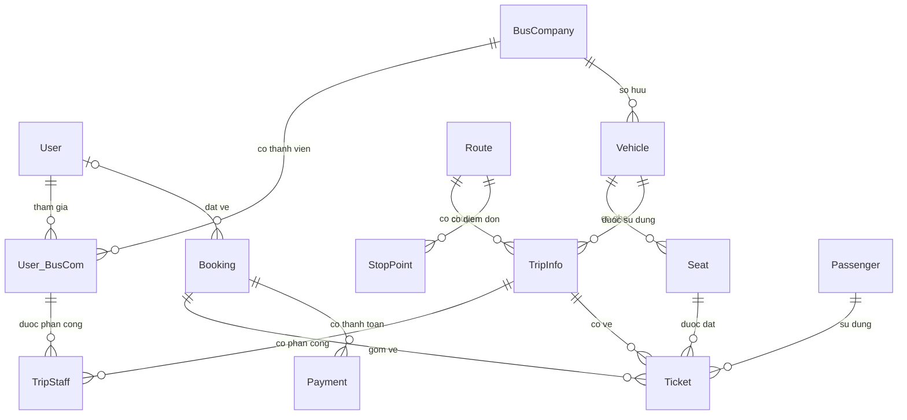

# Website quản lý bán vé xe đường dài

## Cài đặt và cấu hình môi trường

### Yêu cầu

- JDK 21
- Maven
- Node.js và npm
- MySQL đang chạy; database mặc định là `road_ticket` trên `localhost:3306`

### Tạo Google OAuth Client ID

1. Mở [Google Cloud Console](https://console.cloud.google.com/) và chọn hoặc tạo
   một project.
2. Trong **Google Auth Platform**, cấu hình **Branding** và **Audience**. Khi ứng
   dụng ở chế độ **Testing**, thêm Google account của team vào **Test users**.
3. Vào **Clients** → **Create client** → chọn **Web application**.
4. Trong **Authorized JavaScript origins**, thêm đúng origin frontend, ví dụ
   `http://localhost:5173`. Nếu dùng `127.0.0.1` hoặc port khác, thêm origin đó
   riêng. Chỉ nhập scheme + host + port, không thêm đường dẫn `/login`.
5. Tạo client và lấy **Client ID**. Backend xác minh ID token bằng Client ID;
   luồng này không cần client secret. Không bao giờ đưa client secret vào frontend.

### Cấu hình frontend

Sao chép `frontend/.env.example` thành `frontend/.env.local`, sau đó thay giá trị
`VITE_GOOGLE_CLIENT_ID` bằng Client ID vừa tạo:

```dotenv
VITE_API_BASE_URL=http://localhost:8080
VITE_GOOGLE_CLIENT_ID=your-google-oauth-web-client-id
```

`VITE_GOOGLE_CLIENT_ID` là cấu hình công khai được đóng gói vào frontend; không
đặt password hoặc client secret vào biến `VITE_*`. Vite tự đọc
`frontend/.env.local`; khởi động lại Vite sau khi thay đổi file này.

### Cấu hình backend và gửi email xác thực

Tham khảo `backend/backend/.env.example` để biết các biến cần cấu hình. Spring
Boot **không tự nạp file `.env`**; truyền các giá trị qua Environment Variables
trong cấu hình chạy IDE hoặc terminal. Dùng cùng `GOOGLE_CLIENT_ID` với
`VITE_GOOGLE_CLIENT_ID` và cấu hình SMTP:

| Biến | Bắt buộc | Mục đích |
| --- | --- | --- |
| `GOOGLE_CLIENT_ID` | Có nếu dùng Google login | Google OAuth Web Client ID; phải giống `VITE_GOOGLE_CLIENT_ID`. |
| `MAIL_USERNAME` | Có | Địa chỉ Gmail dùng gửi thư xác thực. |
| `MAIL_PASSWORD` | Có | Google App Password của tài khoản gửi mail, không phải mật khẩu đăng nhập Gmail. |
| `MAIL_HOST` | Không | SMTP host; mặc định `smtp.gmail.com`. |
| `MAIL_PORT` | Không | SMTP port; mặc định `587` (STARTTLS). |
| `APP_BACKEND_URL` | Không | URL backend tạo link xác thực; mặc định `http://localhost:8080`. Khi deploy, đặt URL public của backend. |
| `DB_URL` | Không | JDBC URL; mặc định kết nối MySQL local database `road_ticket`. |
| `DB_USERNAME` / `DB_PASSWORD` | Tùy DB | Tài khoản MySQL; username mặc định là `root`. |
| `JWT_SECRET` | Có theo cấu hình hiện tại | Cấu hình secret cho JWT; dùng một giá trị riêng, mạnh và giữ ngoài Git. |

Để tạo Gmail App Password, bật **2-Step Verification** cho Google account gửi
mail rồi tạo **App Password** trong phần bảo mật tài khoản Google. App Password
chỉ hiển thị một lần; giữ trong secret manager hoặc biến môi trường local, không
commit lên Git. Nếu dùng nhà cung cấp SMTP khác, đặt `MAIL_HOST`, `MAIL_PORT`,
`MAIL_USERNAME`, `MAIL_PASSWORD` theo thông tin nhà cung cấp đó.

Có thể đặt biến trong **Run/Debug → Environment variables** của IDE. Ví dụ chạy
backend local bằng PowerShell từ thư mục gốc repository (điền các giá trị local
của bạn, không commit chúng):

```powershell
$env:GOOGLE_CLIENT_ID = "your-google-oauth-web-client-id"
$env:MAIL_USERNAME = "your-sender@gmail.com"
$env:MAIL_PASSWORD = "your-google-app-password"
$env:APP_BACKEND_URL = "http://localhost:8080"
$env:DB_USERNAME = "root"
$env:DB_PASSWORD = "your-database-password"
$env:JWT_SECRET = "replace-with-a-strong-random-secret"
mvn -f backend\backend\pom.xml spring-boot:run
```

### Khởi chạy

Ở terminal thứ nhất:

```powershell
npm --prefix frontend install
npm --prefix frontend run dev
```

Ở terminal thứ hai, sau khi đã cấu hình environment variables:

```powershell
mvn -f backend\backend\pom.xml spring-boot:run
```

Mở origin frontend đã đăng ký với Google, thường là `http://localhost:5173`.
Đăng ký bằng email/mật khẩu gửi link xác thực qua SMTP. Google login xác minh
email bằng Google và không cần bước xác thực email riêng của ứng dụng.

### Khởi tạo tài khoản admin (tùy chọn)

Để tạo tài khoản admin lần đầu khi backend khởi động, cấu hình thêm
`ADMIN_EMAIL`, `ADMIN_USERNAME` và `ADMIN_PASSWORD`. Username cần từ 4 đến 50 ký
tự, mật khẩu từ 8 đến 72 ký tự. Mật khẩu được mã hóa BCrypt trước khi lưu. Nếu
không cấu hình các biến này, bước khởi tạo admin sẽ được bỏ qua. Tài khoản đã
tồn tại sẽ không bị cập nhật hoặc tự nâng quyền.

Tài liệu này mô tả vai trò và quan hệ của 13 entity hiện có trong backend. Mã nguồn nằm tại [thư mục entity](backend/backend/src/main/java/backend/backend/entity).

## Vai trò từng entity

| Entity | Bảng dữ liệu | Vai trò | Dữ liệu chính |
| --- | --- | --- | --- |
| `User` | `users` | Tài khoản sử dụng hệ thống, có thể là khách hàng, nhân viên, nhà xe hoặc quản trị viên. | Username, mật khẩu, email, điện thoại, quyền `role`. |
| `BusCompany` | `bus_companies` | Nhà xe cung cấp dịch vụ vận chuyển. | Tên nhà xe, mô tả. |
| `User_BusCom` | `user_companies` | Ghi nhận một tài khoản là thành viên của một nhà xe. Đây là entity trung gian giữa User và BusCompany. | Tài khoản, nhà xe, chức vụ `position`, trạng thái `active`. |
| `Vehicle` | `vehicles` | Xe thuộc nhà xe, được sử dụng để chạy các chuyến. | Nhà xe, biển số, tên xe, loại xe, sức chứa, trạng thái hoạt động. |
| `Seat` | `seats` | Một ghế hoặc giường cố định trên xe. | Xe, số ghế, tầng, trạng thái hoạt động. |
| `Route` | `routes` | Tuyến đường giữa điểm đi và điểm đến, có thể được sử dụng cho nhiều chuyến. | Điểm đi, điểm đến, khoảng cách km, thời gian dự kiến phút. |
| `StopPoint` | `stop_point` | Điểm đón khách dọc theo một tuyến, được sắp xếp theo thứ tự trên tuyến. | Tuyến, tên điểm dừng, địa chỉ, thứ tự, trạng thái hoạt động. |
| `TripInfo` | `trips` | Một chuyến xe cụ thể có lịch khởi hành, xe sử dụng và giá vé. | Tuyến, xe, giờ đi, giờ đến, giá vé, trạng thái chuyến. |
| `TripStaff` | `trip_staff` | Phân công một thành viên nhà xe tham gia một chuyến cụ thể. | Chuyến, thành viên `User_BusCom`, chức vụ trên chuyến. |
| `Passenger` | `passengers` | Người thực tế đi xe, có thể khác người đặt vé. | Họ tên, điện thoại, email, số giấy tờ tùy thân. |
| `Booking` | `bookings` | Đơn đặt vé, tập hợp thông tin người liên hệ và tổng tiền của các vé. | Mã đơn, tài khoản đặt nếu có, thông tin liên hệ, tổng tiền, trạng thái, thời gian tạo và hết hạn giữ chỗ. |
| `Ticket` | `tickets` | Vé cho một hành khách ngồi một ghế trên một chuyến cụ thể. | Mã vé, đơn đặt, chuyến, ghế, hành khách, giá lúc đặt, trạng thái, điểm đón và trả. |
| `Payment` | `payments` | Một lần thanh toán hoặc thử thanh toán cho đơn đặt vé. | Đơn đặt, số tiền, phương thức, trạng thái, mã giao dịch, thời gian tạo và thanh toán. |

## Sơ đồ quan hệ

Trong sơ đồ, `||` nghĩa là đúng một, `o|` là không có hoặc một, và `o{` là không có hoặc nhiều. Một bản ghi cha có thể chưa có bản ghi con, ví dụ đơn mới tạo chưa có thanh toán.



## Chi tiết quan hệ và khóa ngoại

Mỗi quan hệ bên dưới được ánh xạ bằng `@ManyToOne(fetch = FetchType.LAZY)` ở entity chứa khóa ngoại. Nhìn từ phía entity cha, đây là quan hệ một–nhiều.

| Entity chứa khóa ngoại | Thuộc tính Java | Cột khóa ngoại | Entity được tham chiếu | Ý nghĩa |
| --- | --- | --- | --- | --- |
| `User_BusCom` | `user` | `user_id` | `User` | Một tài khoản có thể tham gia nhiều nhà xe. |
| `User_BusCom` | `busCompany` | `company_id` | `BusCompany` | Một nhà xe có thể có nhiều thành viên. |
| `Vehicle` | `busCompany` | `company_id` | `BusCompany` | Một nhà xe sở hữu nhiều xe; mỗi xe thuộc một nhà xe. |
| `Seat` | `vehicle` | `vehicle_id` | `Vehicle` | Một xe có nhiều ghế; mỗi ghế thuộc một xe. |
| `TripInfo` | `route` | `route_id` | `Route` | Một tuyến có nhiều chuyến; mỗi chuyến chạy trên một tuyến. |
| `StopPoint` | `route` | `route_id` | `Route` | Một tuyến có nhiều điểm đón; mỗi điểm dừng thuộc một tuyến. |
| `TripInfo` | `vehicle` | `vehicle_id` | `Vehicle` | Một xe có thể chạy nhiều chuyến ở các thời điểm khác nhau. |
| `TripStaff` | `trip` | `trip_id` | `TripInfo` | Một chuyến có nhiều phân công nhân viên. |
| `TripStaff` | `staff` | `user_company_id` | `User_BusCom` | Một thành viên nhà xe có thể được phân công nhiều chuyến. |
| `Booking` | `user` | `user_id` | `User` | Một tài khoản có thể đặt nhiều đơn. Khóa ngoại này được phép trống để hỗ trợ khách vãng lai. |
| `Ticket` | `booking` | `booking_id` | `Booking` | Một đơn có thể chứa nhiều vé; mỗi vé thuộc một đơn. |
| `Ticket` | `trip` | `trip_id` | `TripInfo` | Một chuyến có nhiều vé; mỗi vé ứng với một chuyến. |
| `Ticket` | `seat` | `seat_id` | `Seat` | Một ghế xuất hiện trên nhiều vé qua các chuyến hoặc lịch sử hủy vé. |
| `Ticket` | `passenger` | `passenger_id` | `Passenger` | Một hành khách có thể có nhiều vé; mỗi vé gắn với một hành khách. |
| `Payment` | `booking` | `booking_id` | `Booking` | Một đơn có thể có nhiều lần thử thanh toán; mỗi lần thuộc một đơn. |

Tất cả khóa ngoại trong bảng trên đều bắt buộc ở cơ sở dữ liệu, ngoại trừ `Booking.user_id`.

Hai quan hệ nhiều–nhiều được biểu diễn thông qua entity trung gian:

- `User ↔ BusCompany` qua `User_BusCom`, để lưu thêm chức vụ và trạng thái thành viên.
- `TripInfo ↔ User_BusCom` qua `TripStaff`, để lưu chức vụ trong từng chuyến.

Code hiện chỉ khai báo quan hệ một chiều. Ví dụ `Ticket` có thuộc tính `booking`, nhưng `Booking` chưa có danh sách `tickets`. Có thể lấy các vé của đơn bằng truy vấn repository theo booking. Các quan hệ cũng chưa khai báo cascade; khi lưu hoặc xóa dữ liệu, service cần xử lý các bản ghi liên quan.

## Những khái niệm dễ nhầm

### Route và TripInfo

`Route` mô tả tuyến, ví dụ TP.HCM → Đà Lạt. `TripInfo` mô tả một chuyến chạy trên tuyến đó, ví dụ khởi hành lúc 22:00 ngày 10/10/2026 bằng xe 51B-12345. Cùng một tuyến có thể có nhiều chuyến với giờ đi, xe và giá khác nhau.

Nhà xe của một chuyến được xác định qua `TripInfo.vehicle.busCompany`. Hiện `Route` không gắn trực tiếp với nhà xe nên nhiều nhà xe có thể sử dụng cùng một tuyến.

### Route và StopPoint

`StopPoint` là một địa điểm đón khách dọc theo `Route`, không phải một chuyến xe cụ thể. Mỗi điểm dừng có tên, địa chỉ và `sequenceNumber` để xác định thứ tự đón trên tuyến; thứ tự này là duy nhất trong cùng một tuyến. `active` cho biết điểm đón còn được sử dụng hay không. Điểm dừng không lưu trong danh sách hai chiều ở `Route`; có thể truy vấn theo tuyến qua repository.

`Ticket.pickupLocation` và `Ticket.dropoffLocation` hiện vẫn là chuỗi, chưa liên kết khóa ngoại tới `StopPoint`. Service cần kiểm tra điểm đón/trả hợp lệ khi tạo vé nếu muốn giới hạn lựa chọn theo các điểm dừng của tuyến.

### User và Passenger

`User` là tài khoản đăng nhập; `Passenger` là người đi xe. Một khách hàng có thể dùng tài khoản của mình để đặt vé cho người thân. Hiện Passenger không có khóa ngoại liên kết trực tiếp với User.

### Booking và Ticket

`Booking` là đơn đặt; `Ticket` là từng vé trong đơn. Ví dụ một người đặt cho ba hành khách thì tạo một Booking và ba Ticket, mỗi Ticket gắn với một hành khách và một ghế.

Hiện Booking không gắn trực tiếp với một chuyến; chuyến được xác định trên từng Ticket. Nếu nghiệp vụ yêu cầu mọi vé trong một đơn thuộc cùng chuyến, service cần kiểm tra điều này.

### Seat và trạng thái còn chỗ

`Seat.active` cho biết ghế có được sử dụng hay không, ví dụ ghế hỏng có thể bị vô hiệu hóa. Thuộc tính này không thể hiện ghế đã được đặt trên một chuyến cụ thể.

Muốn xác định ghế còn trống phải kiểm tra Ticket theo cả chuyến và ghế, kết hợp trạng thái vé và thời hạn giữ chỗ của Booking.

### UserRole và StaffPosition

`User.role` xác định quyền ở cấp hệ thống, như CUSTOMER, ADMIN hoặc STAFF. `User_BusCom.position` xác định chức vụ tại nhà xe. `TripStaff.position` xác định chức vụ khi tham gia một chuyến cụ thể.

## Ví dụ luồng đặt vé

1. Nhà xe tạo Vehicle và các Seat của xe.
2. Tạo Route và các StopPoint theo thứ tự dọc tuyến, sau đó tạo TripInfo với tuyến, xe, giờ đi, giờ đến và giá vé.
3. Phân công tài xế, phụ xe bằng TripStaff, tham chiếu các thành viên User_BusCom.
4. Khách chọn chuyến và ghế. Hệ thống tạo Booking với thông tin liên hệ.
5. Tạo hoặc sử dụng Passenger cho từng người đi, rồi tạo Ticket liên kết đơn, chuyến, ghế và hành khách.
6. Tạo Payment cho lần thanh toán. Sau khi xác nhận thanh toán hợp lệ, service cập nhật Payment, Booking và các Ticket theo nghiệp vụ.

Ví dụ: tài khoản An đặt hai ghế A01 và A02 cho Bình và Chi. Booking liên kết User của An; hai Ticket cùng thuộc Booking đó nhưng liên kết hai Passenger khác nhau.

## Ràng buộc hiện có và quy tắc cần bổ sung ở service

Các ràng buộc duy nhất đã khai báo:

- `User`: username, email và phone; email và phone được phép trống.
- `BusCompany`: tên nhà xe.
- `Vehicle`: biển số xe.
- `User_BusCom`: cặp `(user_id, company_id)`.
- `Seat`: cặp `(vehicle_id, seat_number)`.
- `TripStaff`: cặp `(trip_id, user_company_id)`.
- `Booking`: mã đơn; `Ticket`: mã vé; `Payment`: mã giao dịch khi có giá trị.

Bean Validation đã khai báo kiểm tra giờ đến sau giờ đi, giá và số tiền không âm, sức chứa xe dương cùng các trường bắt buộc. Các kiểm tra này cần được kích hoạt qua cơ chế validation của ứng dụng.

Các quy tắc giữa nhiều bản ghi cần thực hiện ở service:

- Ghế của vé phải thuộc xe được sử dụng cho chuyến.
- Nhân viên được phân công phải đang hoạt động và thuộc đúng nhà xe của chuyến.
- Một ghế trên một chuyến không được bán đồng thời cho nhiều hành khách; cần kiểm tra và giữ chỗ trong transaction có cơ chế khóa phù hợp.
- Không bố trí cùng xe hoặc nhân viên vào các chuyến trùng lịch.
- Tổng tiền đơn phải khớp giá các vé; thanh toán và chuyển trạng thái phải được xác nhận theo nghiệp vụ.
- Đơn hết hạn hoặc bị hủy cần giải phóng chỗ; cần giữ lịch sử vé và thanh toán.

Entity chưa tự triển khai các quy tắc service này. Xem thêm [ghi chú mô hình dữ liệu](backend/backend/ENTITY_MODEL.md).

## Frontend

Frontend được xây dựng bằng React và Vite. Cần cài Node.js trước khi chạy.

```powershell
cd frontend
npm install
npm run dev
```

Tạo bản build production bằng `npm run build`; chạy thử bản build bằng `npm run preview`.
